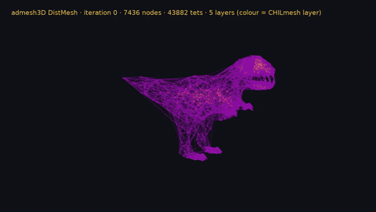

<p align="center"></p>

<h1 align="center">admesh3D</h1>

<p align="center"><strong>Tetrahedral meshing of signed-distance-function domains and sigma-layer prism extrusion, in the ADMESH family.</strong></p>

<p align="center">
<a href="https://pypi.org/project/admesh3D/"></a>
<a href="https://pypi.org/project/admesh3D/"></a>
<a href="https://github.com/domattioli/admesh3D/blob/main/LICENSE"></a>
<a href="https://github.com/domattioli/admesh3D/actions/workflows/release.yml"></a>
<a href="https://doi.org/10.5281/zenodo.24043645"></a>
</p>

## Table of Contents

- [Status & Roadmap](#status--roadmap)
- [Installation](#installation)
- [Quick start](#quick-start)
- [Examples](#examples)
- [Limitations](#limitations)
- [Citation](#citation)
- [License](#license)

## Status & Roadmap

Experimental prototype, version 0.1.1 (pre-alpha). The API may change without notice.

- **Now:** first tagged release; tetrahedra from a signed distance function (3D DistMesh), sigma-layer prisms, quality report, ASCII `.vtu` output.
- **Next:** API review after first user feedback (no date).
- **Later:** one ecosystem with ADMESH, CHILmesh and QuADMESH.

## Installation

```bash
pip install admesh3D            # import name: admesh3d
pip install "admesh3D[admesh2d]"  # optional link to the 2D generator
```

Requires Python 3.10+, `numpy` and `scipy`. From a clone: `pip install -e ".[test]" && pytest -q`.

## Quick start

```python
import admesh3d as am

m = am.tetrahedralize(am.Box((0,0,0),(1,1,1)), h_max=0.1)
print(m.quality_report())
m.to_vtu("cube.vtu")               # open in ParaView

ball = am.Sphere((0,0,0), 1.0) - am.Cylinder((0,0,0), 0.3, 3.0)
am.tetrahedralize(ball, h_min=0.1, h_max=0.15).to_vtu("ball.vtu")

import numpy as np
nodes = np.array([[0,0],[1,0],[1,1],[0,1]], float)
tris  = np.array([[0,1,2],[0,2,3]])
p = am.extrude(nodes=nodes, triangles=tris, depth=np.full(4,10.0), layers=5)
assert p.n_elements == 10 and p.n_nodes == 24
assert abs(p.volumes.sum() - 10.0) < 1e-9
```

## Examples

The hero animation above shows a T-rex surface filled with tetrahedra; element
layers are revealed from the innermost layer outward. The test suite under
[`tests/`](https://github.com/domattioli/admesh3D/tree/main/tests) holds one runnable case per feature.

## Limitations

- Prototype: no stability guarantee, no production use.
- DistMesh relaxation is iterative and serial; large domains are slow, and the quality report
  does not guarantee a minimum element quality.
- Input domains are signed distance functions or extruded 2D triangle meshes. Arbitrary CAD
  surfaces and STL files are not read.
- Output is ASCII `.vtu` only. No ADCIRC 3D file format is written.
- The `admesh2D` link is optional and tested only by a smoke test.

## Citation

Cite the concept DOI, which always resolves to the latest release: [10.5281/zenodo.24043645](https://doi.org/10.5281/zenodo.24043645).

```bibtex
@software{mattioli_admesh3d,
  author  = {Mattioli, Dominik O.},
  title   = {admesh3D: experimental 3D mesher in the ADMESH family},
  year    = {2026},
  url     = {https://github.com/domattioli/admesh3D},
  doi     = {10.5281/zenodo.24043645},
  version = {0.1.1}
}
```

## License

[PolyForm Noncommercial License 1.0.0](https://github.com/domattioli/admesh3D/blob/main/LICENSE).
Commercial use needs a separate license; contact via [github.com/domattioli](https://github.com/domattioli).
